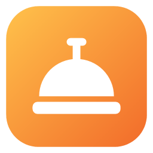
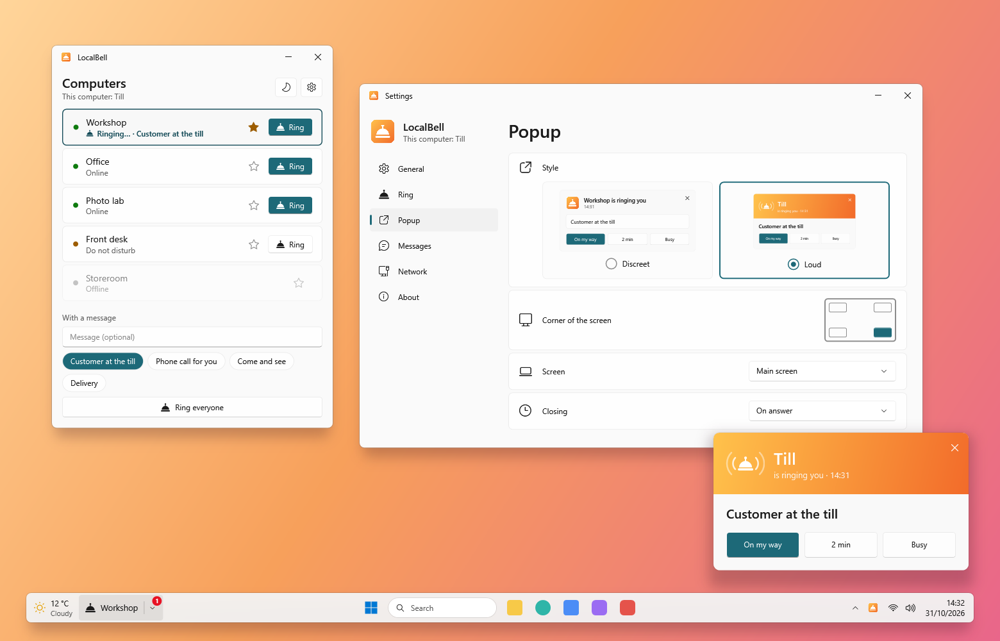

<p align="center">
  
</p>

<h1 align="center">LocalBell</h1>

<p align="center">
  Une sonnette entre les PC de votre magasin ou de votre bureau : sonnez un collègue, avec ou sans message.
</p>

<p align="center">
  <a href="README.md">English</a> · <b>Français</b>
</p>

<p align="center">
  
</p>

---

## Fonctionnalités

Installez LocalBell sur chaque PC et donnez une fois un nom à chacun : chaque PC du réseau local voit les autres et peut
les sonner. Pas de serveur, pas de compte, pas d'internet.

### Sonner

- **Sonner** un poste en un clic, avec un message ou non ; des messages tout prêts en un clic (« Client en caisse »).
- **Sonner tout le monde** en deux clics : le premier demande le second.
- La ligne du poste sonné dit ce qui se passe : ça sonne, sa réponse (« J'arrive »), pas de réponse, ne pas déranger.
- Un favori (l'étoile), sonné en un clic depuis la barre des tâches.

### Être sonné

- Une popup dans un coin de l'écran, discrète ou voyante, qui ne prend jamais le clavier de l'appli en cours.
- La cloche sonne jusqu'à une réponse (3 fois par défaut) ; les réponses se font en un clic.
- Un volume à elle, et elle sonne même quand le son de Windows est coupé ; trois cloches, ou votre propre WAV ou MP3.
- **Ne pas déranger** pendant 30 minutes, une heure, jusqu'à demain : ni son ni popup, les sonneries gardées pour
  rappeler plus tard.

### Dans la barre des tâches

- Un widget après la météo (ou près de l'horloge) : la cloche, ou la cloche et votre favori, une pastille pour les
  sonneries manquées ; il se décale pour les widgets des autres applis.
- Une cloche près de l'horloge aussi : ouvrir, ne pas déranger, paramètres, quitter.

### Sur n'importe quel réseau

- Les postes se trouvent sur toutes les cartes réseau, sinon en interrogeant les adresses autour d'eux.
- Derrière un routeur : ajoutez une fois un poste par son adresse IP ; chacun partage les postes qu'il connaît.

### Et aussi

Anglais et français, thème clair ou sombre, démarrage avec Windows, Windows 10 et 11.

## Installation

1. Téléchargez `LocalBell-Setup-x.y.z.exe` depuis la page [Releases](../../releases).
2. Lancez-le. L'installeur n'étant pas signé, Windows SmartScreen peut afficher « Windows a protégé votre ordinateur » :
   cliquez sur **Informations complémentaires → Exécuter quand même**.
3. Acceptez la demande d'administrateur (UAC).

L'installeur :

- copie l'appli dans `C:\Program Files\LocalBell` et l'ajoute au menu Démarrer (raccourci sur le bureau en option) ;
- **laisse passer LocalBell dans le pare-feu de Windows** (une règle pour l'appli, tous les profils réseau) : les autres
  postes doivent pouvoir la joindre ;
- propose d'installer le **.NET 10 Desktop Runtime** de Microsoft s'il manque.

Installez-la sur chaque PC, puis donnez son nom à chacun dans **Paramètres → Général**.

Pour désinstaller : **Paramètres → Applications → Applications installées → LocalBell**. Le désinstalleur retire
l'appli et sa règle de pare-feu, et demande s'il faut aussi supprimer vos réglages (Non par défaut).

**Configuration requise :** Windows 10 2004 ou plus récent, x64 ; les PC sur le même réseau local, ou joignables par
leur adresse.

## Développement

### Prérequis

Tout s'installe avec `winget` (intégré à Windows 11), depuis un terminal :

| Outil | Rôle | Installation |
|-------|------|--------------|
| **Git** | Récupérer le code | `winget install Git.Git` |
| **SDK .NET 10** | Compiler l'appli (C# / WPF) et lancer les tests | `winget install Microsoft.DotNet.SDK.10` |
| **Inno Setup 6** | Construire l'installeur | `winget install JRSoftware.InnoSetup` |

### Compiler

```powershell
.\scripts\build.ps1
```

Le script lance les tests, puis produit dans `dist\` l'appli (`app\`, dépendante du framework) et l'installeur
(`LocalBell-Setup-<version>.exe`). Options : `-SkipTests`, `-NoInstaller`.

### Pendant le développement

```powershell
dotnet test tests\LocalBell.Core.Tests                                       # tests unitaires
dotnet run --project src\LocalBell.App -- --profile test-a --no-scan         # un LocalBell avec ses propres réglages
```

`--profile NOM` lance un LocalBell avec ses propres réglages et son propre identifiant, pour en essayer deux sur un même
PC ; `--no-widget` le lance sans widget dans la barre des tâches, `--no-scan` sans balayage du réseau.
`LOCALBELL_LANG` (`en`, `fr`) et `LOCALBELL_THEME` (`Light`, `Dark`) imposent la langue et le thème.

### Organisation du code

```
src/
  LocalBell.Core/   Le réseau, sans interface : découverte (multicast et broadcast UDP sur chaque carte,
                   balayage du réseau), le petit serveur HTTP de chaque PC, les postes connus, sonner et répondre
  LocalBell.App/    Appli WPF : la liste, la popup, les sonneries, le widget de la barre des tâches, la cloche
                   près de l'horloge, les paramètres, les textes de l'interface
installer/         Script Inno Setup de l'installeur (avec sa règle de pare-feu)
scripts/           build.ps1 (compilation complète), make-icons.cs (régénère l'icône)
tests/             Tests unitaires (xUnit), plusieurs LocalBell qui se parlent sur 127.0.0.1
docs/              Icône du README
.github/workflows/ Compilation automatique sur GitHub (et publication des versions)
```

### Comment les postes se parlent

Chaque PC s'annonce sur le port UDP **53318** (groupe multicast `224.0.0.168` et adresse de broadcast de chaque carte
réseau), et répond à de petites requêtes JSON sur son port TCP (53318, ou le suivant de libre) :
`POST /api/localbell/v1/hello`, `GET /api/localbell/v1/peers`, `POST /api/localbell/v1/ring`, `POST /api/localbell/v1/reply`.

### Traductions

Textes de l'appli : `src/LocalBell.App/Properties/Strings.resx` (anglais, par défaut) et `Strings.fr.resx` (français) ;
les tests vérifient qu'ils ont les mêmes clés et les mêmes paramètres. Messages de l'installeur : `installer/LocalBell.iss`.

### Icône

`dotnet run scripts\make-icons.cs` dessine l'icône (`src/LocalBell.App/Assets/LocalBell.ico`, son image en 256 px, et
`docs/icon-256.png`) ; ses petites tailles sont dessinées au pixel près. Les fichiers sont versionnés : ne le relancez
que pour changer le dessin.

### Publier une version

1. Mettez à jour `<Version>` dans `Directory.Build.props`.
2. Commitez, puis créez et poussez un tag : `git tag v1.0.0`, puis `git push origin v1.0.0`.
3. Le workflow GitHub Actions compile, teste et publie l'installeur dans une Release.

## Feuille de route

- [ ] Les mises à jour depuis l'appli.
- [ ] Le widget de la barre des tâches visible quand le menu Démarrer est ouvert.
- [ ] **Signature gratuite** de l'installeur via [SignPath Foundation](https://signpath.org) (pour les projets open source).

## Politique de confidentialité

LocalBell ne parle qu'aux PC de votre réseau local, et à ceux que vous ajoutez par leur adresse : leurs noms, leur
statut, les sonneries et les messages que vous envoyez. Rien ne part sur internet, il n'y a ni compte ni statistiques.
Les messages ne sont pas chiffrés : n'envoyez pas de secrets.

Le lien *Code source sur GitHub* des Paramètres ne s'ouvre dans votre navigateur que si vous cliquez dessus.

## Licence

[MIT](LICENSE.md).

## Crédits

Développé par [QuentinPerou](https://github.com/quentinperou), avec [Claude Code](https://claude.com/claude-code) (Anthropic).
