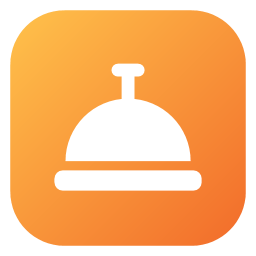
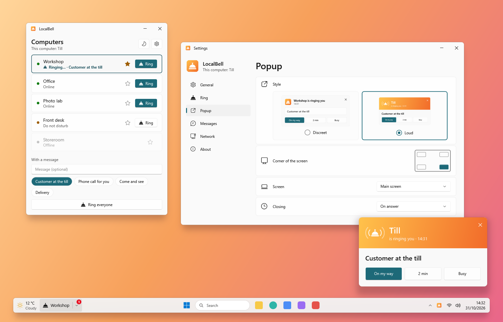

<p align="center">
  
</p>

<h1 align="center">LocalBell</h1>

<p align="center">
  A doorbell between the computers of your shop or office: ring a colleague, with or without a message.
</p>

<p align="center">
  <b>English</b> · <a href="README.fr.md">Français</a>
</p>

<p align="center">
  
</p>

---

## Features

Install LocalBell on each computer and name each one once: every computer of the local network sees the others and
can ring them. No server, no account: the computers talk on the local network only.

### Ringing

- **Ring** a computer in one click, with a message or not; ready-made messages in one click ("Customer at the till").
- **Ring everyone** in two clicks: the first one asks for the second.
- The row of the computer rung tells what happens: ringing, its reply ("On my way"), no answer, do not disturb.
- A favourite (the star), rung in one click from the taskbar.

### Being rung

- A popup in a corner of the screen, discreet or loud, that never takes the keyboard from the app in use.
- The bell rings until someone answers (3 times by default); the replies are one click.
- A volume of its own, and it rings even when the Windows sound is off; three bells, or your own WAV or MP3.
- **Do not disturb** for 30 minutes, an hour, until tomorrow: no sound, no popup, the rings kept to ring back later.

### In the taskbar

- A widget after the weather (or near the clock): the bell, or the bell and your favourite, a badge for the missed
  rings; it moves aside for the widgets of other apps.
- A bell near the clock too: open, do not disturb, settings, quit.

### On any network

- The computers find each other on every network card, else by asking the addresses around them.
- Behind a router: add a computer once by its IP address; each one shares the computers it knows.

### And also

English and French, light or dark theme, starts with Windows, Windows 10 and 11. **Updates in one click** from the
app (GitHub Releases).

## Installation

1. Download `LocalBell-Setup-x.y.z.exe` from the [Releases](../../releases) page.
2. Run it. As the installer is not signed, Windows SmartScreen may show “Windows protected your PC”:
   click **More info → Run anyway**.
3. Accept the administrator prompt (UAC).

The installer:

- copies the app to `C:\Program Files\LocalBell` and adds it to the Start menu (desktop shortcut optional);
- **lets LocalBell through the Windows firewall** (one rule for the app, every network profile): the other computers
  must reach it;
- offers to install the Microsoft **.NET 10 Desktop Runtime** if it is missing.

Install it on every computer, then give each one its name in **Settings → General**.

To uninstall: **Settings → Apps → Installed apps → LocalBell**. The uninstaller removes the app and its firewall rule,
and asks whether to delete your settings too (No by default).

**Requirements:** Windows 10 2004 or later, x64; the computers on the same local network, or reachable by their address.

## Development

### Prerequisites

Everything installs with `winget` (built into Windows 11), from a terminal:

| Tool | Purpose | Install |
|------|---------|---------|
| **Git** | Get the code | `winget install Git.Git` |
| **.NET 10 SDK** | Build the app (C# / WPF) and run the tests | `winget install Microsoft.DotNet.SDK.10` |
| **Inno Setup 6** | Build the installer | `winget install JRSoftware.InnoSetup` |
| **Windows SDK** | `makeappx` and `makepri`, to pack the Microsoft Store version | `winget install Microsoft.WindowsSDK.10.0.26100` |

### Build

```powershell
.\scripts\build.ps1
.\scripts\build-store.ps1
```

`build.ps1` runs the tests, then produces in `dist\` the app (`app\`, framework-dependent) and the installer
(`LocalBell-Setup-<version>.exe`). Options: `-SkipTests`, `-NoInstaller`.

`build-store.ps1` produces `dist\store\LocalBell_<version>.0_x64.msix`, the same app with .NET inside, not signed
(the Store signs it). In it, LocalBell starts with Windows through its startup task, its firewall rules come with the
package, and the Store updates it.

### While developing

```powershell
dotnet test tests\LocalBell.Core.Tests                                       # unit tests
dotnet run --project src\LocalBell.App -- --profile test-a --no-scan         # a LocalBell with settings of its own
```

`--profile NAME` runs a LocalBell with its own settings and id, to try two of them on one computer; `--no-widget`
leaves out its taskbar widget, `--no-scan` its scan of the network. `LOCALBELL_LANG` (`en`, `fr`) and
`LOCALBELL_THEME` (`Light`, `Dark`) force the language and the theme.

### Code layout

```
src/
  LocalBell.Core/   The network, without UI: discovery (UDP multicast and broadcast on every card, a scan of
                   the network), the little HTTP server of each computer, the computers known, ringing and replies
  LocalBell.App/    WPF app: the list, the popup, the bell sounds, the taskbar widget, the bell near the clock,
                   Settings, UI strings
installer/         Inno Setup script of the installer (with its firewall rule)
store/             The Microsoft Store package: its manifest, its logos, the text of its listing
scripts/           build.ps1 (full build), build-store.ps1 (Store package), make-icons.cs (regenerates the icons)
tests/             Unit tests (xUnit), several LocalBell talking on 127.0.0.1
docs/              README icon
.github/workflows/ Automated build on GitHub (and release publishing)
```

### How the computers talk

Each computer announces itself on UDP port **53318** (multicast group `224.0.0.168` and the broadcast address of each
network card), and answers small JSON requests on its TCP port (53318, or the next free one):
`POST /api/localbell/v1/hello`, `GET /api/localbell/v1/peers`, `POST /api/localbell/v1/ring`, `POST /api/localbell/v1/reply`.

### Translations

App texts: `src/LocalBell.App/Properties/Strings.resx` (English, the default) and `Strings.fr.resx` (French); the tests
check that both have the same keys and placeholders. Installer messages: `installer/LocalBell.iss`.

### Icon

`dotnet run scripts\make-icons.cs` draws the icon (`src/LocalBell.App/Assets/LocalBell.ico`, its 256 px image, and
`docs/icon-256.png`, the logos of the Store package in `store/Assets`); its small sizes are drawn on whole pixels. The
files are committed: run it again only to change the design.

### Releasing a version

1. Update `<Version>` in `Directory.Build.props`.
2. Commit, then create a tag and push both: `git tag v1.0.0`, then `git push origin main v1.0.0`.
3. The GitHub Actions workflow builds, tests and publishes the installer in a Release; the app finds it at its next
   start. A tag with a suffix (`v1.1.0-beta.1`) is a pre-release, offered to the Beta channel only.
4. For the Store: `.\scripts\build-store.ps1`, then a new submission in Partner Center with the new `.msix`
   (`store/listing.md` has the texts of the listing).

## Roadmap

- [ ] In the Microsoft Store.
- [ ] **Free signing** of the installer through [SignPath Foundation](https://signpath.org) (for open source projects).

## Privacy policy

LocalBell talks only to the computers of your local network, and to those you add by their address: their names,
their status, the rings and the messages you send. There is no account and no statistics. The messages are not
encrypted: do not send secrets.

The only access to the internet is the update check: at startup (it can be turned off in **Settings → Updates**)
the app asks GitHub (`api.github.com`) for the latest version, and downloads its installer from GitHub when you click
**Update**. The Microsoft Store version has none (the Store updates it).

The link *Source code on GitHub* in Settings opens in your browser only when you click it.

## License

[MIT](LICENSE.md).

## Credits

Developed by [QuentinPerou](https://github.com/quentinperou), with [Claude Code](https://claude.com/claude-code) (Anthropic).
